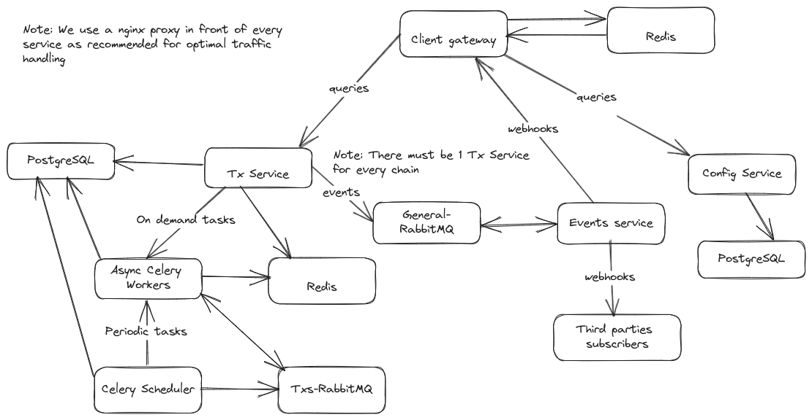

# Safe Infrastructure

> Please note that software releases of some Safe services after Feb 17, 2026 are published by Safe Labs under **FSL-1.1-MIT license**.
> This license does not permit making the software available to others in certain commercial products or services. You can find the applicable license texts in each GitHub repository and more information in our [blog](https://safe.global/blog/providing-the-infrastructure-for-self-custody-for-the-next-generation).

**Safe infrastructure diagram**

<figure></figure>

- **Tx Service** is the core of the Safe. It indexes multisig transactions, module transactions, token transfers, collects signatures... There must be **1 Tx Service per Chain**, with different workers, PostgreSQL, Redis and RabbitMQ.
- **Config Service** holds configuration for every Chain (blockexplorer, tx service url, apps enabled, wallets enabled...). **1 instance of the Config Service supports multiple Chains**
- **Client Gateway** provides an API optimized for clients (web ui, android, ios...). **1 instance of the Client Gateway supports multiple Chains**
- **Events Service** handles Safe indexing events from Transaction Service and deliver as HTTP webhooks.

## Setup

This repository contains the minimum viable local setup for our backend services.
The setup presented here, assumes that only L2 safes will be used. Last stable version will be used for every service, but you can adjust them on `.env`, e.g.:

```bash
CFG_VERSION=v2.112.0
CGW_VERSION=v1.130.0
TXS_VERSION=v6.14.0
UI_VERSION=v1.104.2
EVENTS_VERSION=v1.8.0
```

You can change them to the version you are interested available in [our container registry](https://github.com/orgs/safe-global/packages?repo_name=safe-infrastructure) but be aware that not all versions of our services are compatible with each other, so do so **at your own risk.**

- [Guide to run our services locally](running_locally.md)
- [Guide to run our services for production](running_production.md)
